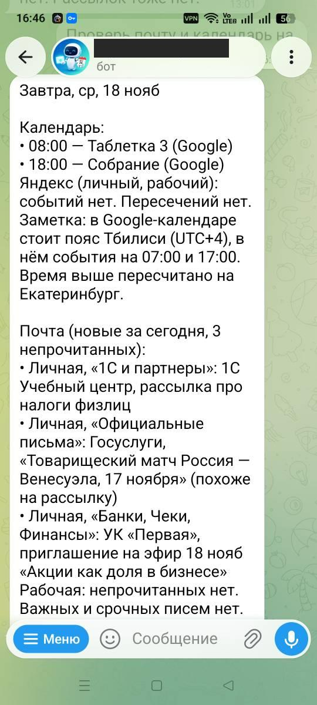
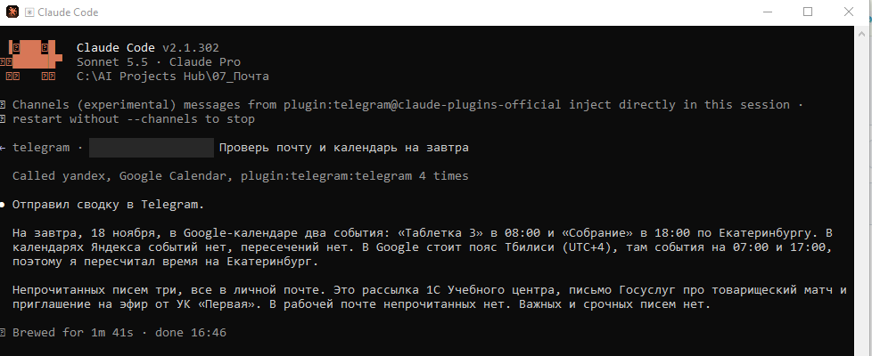

# Telegram-ассистент для Яндекс.Почты и календарей Яндекс и Google

Персональный ИИ-помощник, которым можно управлять с телефона обычными фразами в Telegram. Он сводит в одном чате два почтовых ящика Яндекса и три календаря (Яндекс личный, Яндекс рабочий, Google), готовит черновики ответов и создаёт события. При этом технически не способен отправить, удалить или перенести письмо.

Финальный проект по обучению. Первый пользователь и заказчик — автор проекта, консультант по 1С.

<p align="center">
  
</p>

## Содержание
- [Проблема](#проблема)
- [Для кого](#для-кого)
- [Возможности](#возможности)
- [Примеры диалога](#примеры-диалога)
- [Безопасность](#безопасность)
- [Архитектура](#архитектура)
- [Технологии](#технологии)
- [Структура репозитория](#структура-репозитория)
- [Установка и запуск](#установка-и-запуск)
- [Регулярные сводки](#регулярные-сводки)
- [Известные проблемы](#известные-проблемы)
- [Ограничения текущей версии](#ограничения-текущей-версии)
- [Планы развития](#планы-развития)

## Проблема
- Письма автоматически раскладываются по десяткам папок, поэтому важное легко пропустить. Чтобы увидеть полную картину, приходится вручную обходить папки и переключаться между сервисами.
- Расписание разнесено по разным календарям: пересечения встреч видны только при ручном сравнении.
- Вне рабочего места (в дороге, на встрече) удобнее мессенджер, а не почтовые клиенты.
- Давать ИИ полный доступ к почте рискованно: ошибка или вредная инструкция внутри письма может привести к отправке или удалению писем. Нужен помощник, который удобен и при этом технически не способен навредить.

Что даёт проект: экономия времени на ежедневном разборе почты, меньше риска пропустить письмо клиента или получить конфликт в расписании, безопасная работа ИИ с личными данными.

## Для кого
Занятый специалист с несколькими ящиками и календарями: консультанты, методисты, менеджеры, предприниматели. Технической подготовки не требуется: управление идёт текстом в привычном Telegram.

## Возможности
**Вход:** сообщение в Telegram на естественном языке или автоматический запуск по расписанию. **Выход:** короткий ответ в тот же чат.

| Область | Что умеет |
|---|---|
| Яндекс.Почта (личная и рабочая) | Список непрочитанных по всем папкам, поиск, чтение письма без пометки «прочитано», сохранение черновика ответа в папку «Черновики» |
| Яндекс.Календарь | Просмотр событий, создание события |
| Google Calendar | Просмотр событий, создание события (через коннектор claude.ai) |
| Сопоставление календарей | Поиск пересечений по времени между всеми календарями |
| Регулярные сводки | Ежедневно утром, вечером и по будням в обед, без запроса |

Формат ответов рассчитан на экран телефона:
- сводка по почте: аккаунт, отправитель, тема, папка, важность; рассылки сгруппированы одной строкой, письма клиентов и рабочие выше;
- расписание на день или на завтра: события по времени, календарь-источник, отметка пересечений;
- подтверждение созданного события: где и когда оно появилось;
- черновик письма, сохранённый в «Черновики» Яндекс.Почты.

## Примеры диалога
- «Что нового на почте?»
- «Расписание на завтра»
- «Подготовь черновик ответа на письмо от …»
- «Создай событие …» (бот покажет название, календарь, дату, начало и конец и создаст его только после «да»)

Как это выглядит на практике: запрос в Telegram, обработка в Claude Code и ответ бота.

<p align="center">
  
  </p>

  <p align="center">
  
</p>

Пример вечерней сводки (условный):

```
Вечерняя сводка на вторник.
РАСПИСАНИЕ НА ЗАВТРА:
10:00–11:00 Встреча с клиентом (Google)
15:00–16:00 Совещание (Яндекс рабочий)
Пересечений нет.
НЕПРОЧИТАННАЯ ПОЧТА:
Рабочая — Клиент, «Вопрос по настройке» (папка «Клиенты»)
Личная — рассылки: 12 новых
```

## Безопасность
Принцип минимальных прав: опасные действия не запрещены словами, а отсутствуют как инструменты.

- **Почта.** В MCP-сервере нет инструментов отправки, удаления и перемещения писем и пометки «прочитано». Ассистент только готовит черновик, отправляет человек.
- **Google Calendar.** Удаление и изменение событий и ответы на приглашения заблокированы правилами `deny` в `.claude/settings.json`.
- **События.** Создаются только после показа названия, даты, времени и календаря и ответа «да». Существующие события не меняются и не удаляются.
- **Prompt injection.** Содержимое писем и событий считается данными, а не командами: инструкции внутри писем не выполняются, бот сообщает о них владельцу.
- **Доступ к боту.** Отвечает только владельцу (белый список Telegram, policy allowlist).
- **Секреты.** Доступ к Яндексу по паролям приложений; они лежат в локальном `.env`, который не публикуется (см. `.gitignore`). Токен бота хранится вне репозитория.

## Архитектура
```
Telegram ──> плагин-канал Telegram (Bun) ──> сессия Claude Code (Sonnet 5.5, правила в CLAUDE.md)
                                                   │
                       ┌───────────────────────────┼───────────────────────────┐
                       ▼                                                       ▼
        MCP-сервер «yandex» (server.py, Python)                  Коннектор Google Calendar
        IMAP / CalDAV, аккаунты personal и work                  (только чтение и создание)
```

- Сессия запускается командой `claude --model claude-sonnet-5-5 --channels plugin:telegram@claude-plugins-official` из корня проекта. Плагин Telegram включён только в этой папке.
- **MCP-сервер `yandex`** (`yandex-mcp/server.py`): почта по IMAP (чтение без пометки «прочитано», поиск по всем папкам, кроме «Отправленных», «Черновиков», «Корзины» и «Спама», создание черновиков), календарь по CalDAV (чтение и создание).
- **Правила поведения** задаются промтами в `CLAUDE.md`: ответ только через инструмент `reply`, запреты, правила создания событий, анализ всех папок.
- **Регулярные сводки** выполняет планировщик Windows через `scripts/digest.ps1`: он вызывает `claude -p` (только чтение, плагин Telegram выключен через `scripts/digest-settings.json`) и отправляет результат в чат владельца через Telegram Bot API.

## Технологии
- **Языки и форматы:** Python 3.12, PowerShell, Markdown, JSON.
- **ИИ:** Claude Sonnet 5.5 через Claude Code.
- **Мессенджер:** Telegram Bot API, плагин-канал Telegram для Claude Code (среда Bun).
- **Интеграции:** Яндекс.Почта по IMAP (SSL), Яндекс.Календарь по CalDAV (пароли приложений), Google Calendar через коннектор.
- **Протокол инструментов:** MCP (Model Context Protocol), сервер на FastMCP.
- **Библиотеки Python:** `mcp`, `imapclient`, `caldav`, `icalendar`, `python-dotenv`, `tzdata`.
- **Среда:** Windows 10, планировщик заданий Windows.

## Структура репозитория
| Путь | Назначение |
|---|---|
| `.github/README.md` | Это описание проекта |
| `CLAUDE.md` | Правила поведения бота |
| `.claude/settings.json` | Запреты инструментов Google, включение плагина Telegram |
| `.claude/skills/mail-bot-repo/SKILL.md` | Навык Claude Code для работы с репозиторием: структура, запуск, правки, README, подготовка к публикации |
| `images/` | Картинки для этого README (логотип и скриншоты) |
| `yandex-mcp/server.py` | MCP-сервер для Яндекс.Почты и Яндекс.Календаря |
| `yandex-mcp/requirements.txt` | Зависимости (версия `mcp` закреплена: `mcp<2`) |
| `yandex-mcp/.env.example` | Шаблон файла с паролями приложений |
| `scripts/digest.ps1` | Сводки по расписанию |
| `scripts/prompts/` | Промты утренней, дневной и вечерней сводок |
| `scripts/digest-settings.json` | Настройки для запуска сводок (плагин Telegram выключен) |
| `README.md` (корень) | Техническая документация: файлы, типовые операции, известные грабли |
| `Почта_Описание_проекта_v1_2026-11-16.docx` | Исходное описание проекта |

## Установка и запуск
Нужны: Windows, Python 3.12, Bun, Claude Code с подпиской, бот Telegram (токен от BotFather), пароли приложений Яндекса для личного и рабочего ящиков.

1. Клонировать репозиторий.
2. Создать окружение и поставить зависимости:
   ```
   cd yandex-mcp
   python -m venv .venv
   .venv\Scripts\pip install -r requirements.txt
   ```
3. Скопировать `.env.example` в `.env` и заполнить логины и пароли приложений (почта и календарь отдельно для `PERSONAL` и `WORK`). Часовой пояс по умолчанию `Asia/Yekaterinburg`.
4. Зарегистрировать MCP-сервер:
   ```
   claude mcp add yandex --scope user -- "<путь>\yandex-mcp\.venv\Scripts\python.exe" "<путь>\yandex-mcp\server.py"
   ```
5. Подключить коннектор Google Calendar в аккаунте claude.ai.
6. Настроить Telegram: `/telegram:configure <токен>` в сессии Claude Code, сопряжение владельца и политика allowlist (`/telegram:access`).
7. Проверить подключения: `claude mcp list` из папки проекта (`yandex` и Google Calendar — Connected).
8. Запустить бота из корня проекта:
   ```
   claude --model claude-sonnet-5-5 --channels plugin:telegram@claude-plugins-official
   ```
   Окно не закрывать. Удобно сделать ярлык с этой командой и рабочей папкой проекта.

Подробности эксплуатации (перенос папки, перерегистрация MCP, диагностика) — в [README.md](../README.md) в корне.

## Регулярные сводки
| Время | Когда | Содержание | Режим |
|---|---|---|---|
| 07:30 | ежедневно | Расписание на сегодня (только календари) | `morning` |
| 13:00 | по будням | Непрочитанная почта | `noon` |
| 22:30 | ежедневно | Расписание на завтра и непрочитанная почта | `evening` |

Задания создаются в планировщике Windows и запускают `scripts/digest.ps1 -Mode <режим>`. Не зависят от окна бота, но компьютер должен быть включён.

## Известные проблемы
1. **Бот «молчит».** Плагин Telegram забирает сообщения (getUpdates); если запущено несколько сессий с включённым плагином, лишние перехватывают и теряют сообщения. Плагин включён только в папке проекта и выключен в пользовательских настройках. Проверка: должен быть один процесс `bun.exe` с `server.ts`.
2. **Ответ виден только в терминале.** Бот обязан отвечать инструментом `reply`; правило вынесено в начало `CLAUDE.md`.
3. **Токен бота.** Не показывать в чате и на скриншотах. Если засветился: `/revoke` в BotFather, затем `/telegram:configure <новый>` и перезапуск бота.
4. **Изменения правил** (`CLAUDE.md`, `settings.json`) действуют после перезапуска бота.
5. **Сбои IMAP Яндекса** («problems with connection») разовые: повторить через 20 секунд.
6. **Неразрывные пробелы в именах папок** Яндекса: `server.py` сопоставляет имя с `list_folders()` через `_resolve_folder`.

## Ограничения текущей версии
- Компьютер должен быть включён, бот запущен.
- Ответ приходит от нескольких секунд до двух минут (сводка по двум ящикам).
- Перенос на VPS отклонён: у сервера 1 ГБ RAM при минимуме 4 ГБ для Claude Code.

## Планы развития
- Напоминания о ближайших событиях.
- Шаблоны ответов и автоматическая оценка важности писем с учётом предпочтений.
- Голосовые сообщения (расшифровка речи) и работа с вложениями.
- Поиск свободных окон для встреч.
- Отправка писем только с явным подтверждением каждого письма.
- Работа 24/7 на сервере (тариф от 4 ГБ RAM или облегчённая версия на API).
- Подключение других ящиков и сервисов, например Gmail.
